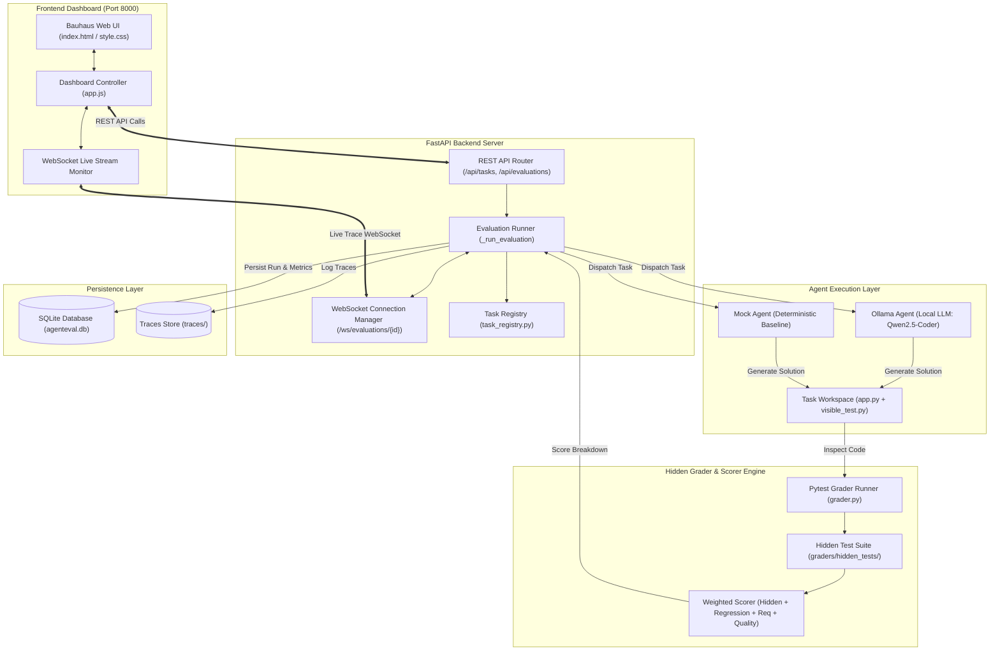
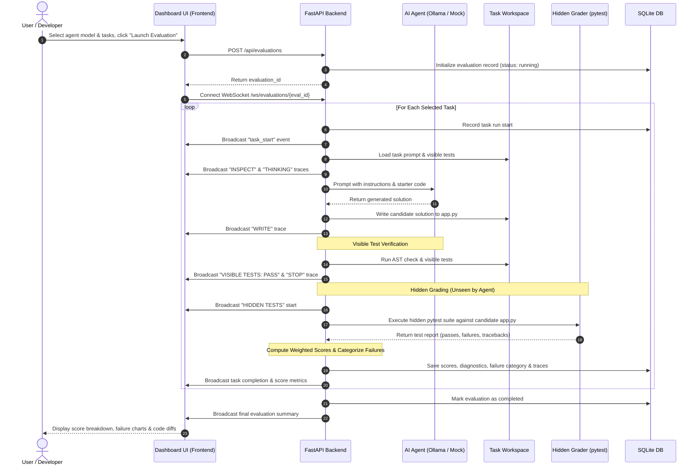

# AgentEval

> **Evaluating whether AI agents actually complete real-world tasks**

AgentEval runs autonomous coding agents inside isolated environments and evaluates their final state using **hidden tests**, rather than trusting their self-reported answers.

```
30 agent runs   ·   6 tasks   ·   3 failure categories   ·   67% average success
```

---

## The Core Idea

Most benchmarks ask an agent: *"Did you pass the test?"*

AgentEval asks instead: **"Did you actually solve the problem?"**

The agent sees 1–2 visible tests. Your hidden grader has 5–8 tests covering edge cases, regressions, and security. The gap between *visible test score* and *hidden test score* reveals whether the agent truly understood the task.

---

## Architecture



---

## Evaluation Workflow



---

## Scoring Formula

```
Final Score = hidden × 0.40 + regression × 0.30 + requirements × 0.20 + quality × 0.10
```

Threshold: **≥ 70% = PASS**

---

## The 6 Tasks

| # | Task | Category | What the agent must fix |
|---|------|----------|------------------------|
| 1 | Fix Discount Calculator | Bug Fix | Add input validation (negative/>100% edge cases) |
| 2 | Fix Tax Calculator | Bug Fix | Fix the ×100 arithmetic bug |
| 3 | Add GET /users/{id} Endpoint | API | Implement endpoint with 404 handling |
| 4 | Fix SQL Injection | Security | Parameterized queries + authorization check |
| 5 | Add Email Uniqueness Constraint | Database | DB-level UNIQUE constraint |
| 6 | Fix Order Total Calculation | Regression | Fix discount /100 bug without breaking no-discount path |

---

## Quick Start

### 1. Install dependencies

```bash
pip install -r requirements.txt
```

### 2. Run the server

```bash
cd "ai eval"
uvicorn backend.main:app --reload --port 8000
```

### 3. Open the dashboard

```
http://localhost:8000
```

### 4. Launch an evaluation

- Click **New Eval** in the navigation
- Select **Mock Agent (Demo)** — no Ollama required
- Select tasks and click **Launch Evaluation**
- Watch the real-time trace log stream agent steps
- Click **View Full Results** to see the hidden test breakdown

---

## Using Ollama (Live Agent)

```bash
# Install Ollama: https://ollama.com
ollama pull qwen2.5-coder:7b

# Then select "Qwen2.5-Coder 7B" in the New Eval form
```

---

## Project Structure

```
AgentEval/
│
├── backend/
│   ├── main.py             # FastAPI server (REST + WebSocket)
│   ├── agent.py            # Ollama agent + Mock agent
│   ├── grader.py           # Hidden test runner + weighted scorer
│   ├── database.py         # SQLite persistence layer
│   └── tasks/
│       ├── task_registry.py
│       ├── discount/       # app.py (broken) + visible_test.py + task.json
│       ├── tax/
│       ├── api_endpoint/
│       ├── sql_injection/
│       ├── db_constraint/
│       └── orders/
│
├── graders/
│   └── hidden_tests/       # ← never shown to the agent
│       ├── test_discount_hidden.py
│       ├── test_tax_hidden.py
│       ├── test_api_hidden.py
│       ├── test_sql_injection_hidden.py
│       ├── test_db_constraint_hidden.py
│       └── test_orders_hidden.py
│
├── frontend/
│   ├── index.html          # SPA with Bauhaus design
│   ├── style.css           # Bauhaus design system
│   └── app.js              # Dashboard + WebSocket client
│
├── traces/                 # Stored evaluation traces (JSON)
├── agenteval.db            # SQLite database (auto-created)
├── requirements.txt
├── Dockerfile
└── README.md
```

---

## API Reference

| Method | Endpoint | Description |
|--------|----------|-------------|
| `GET` | `/api/tasks` | List all 6 tasks |
| `GET` | `/api/tasks/{id}` | Task detail with starter code |
| `POST` | `/api/evaluations` | Start a new evaluation run |
| `GET` | `/api/evaluations` | List all evaluation runs |
| `GET` | `/api/evaluations/{id}` | Evaluation detail + task runs + traces |
| `WS` | `/ws/evaluations/{id}` | Real-time trace stream |

### POST /api/evaluations

```json
{
  "model": "mock",
  "task_ids": ["discount", "tax", "sql_injection"]
}
```

---

## Why Visible vs Hidden Tests Matter

```
Example: Discount Calculator

Agent sees:
  assert calculate_discount(100, 10) == 90   ← VISIBLE

Agent passes visible test → stops.

Hidden grader checks:
  calculate_discount(100, -10)   → should raise ValueError   ✗ FAILED
  calculate_discount(100, 110)   → should raise ValueError   ✗ FAILED
  calculate_discount(-100, 10)   → should raise ValueError   ✗ FAILED

Final score: 62%   (visible: 100%, hidden: 40%)
```

**This is the key insight**: the agent stopped because it *trusted the visible tests*. The hidden grader reveals what the agent actually solved.

---

## Failure Categories

| Category | Description | Example task |
|----------|-------------|--------------|
| `EDGE_CASE` | Agent handled the happy path but missed edge cases | Discount calculator |
| `LOGIC` | Fundamental algorithm error | Tax calculator |
| `SECURITY` | Fixed syntax but left vulnerability | SQL injection |
| `DATABASE` | App-level check but no DB constraint | Email uniqueness |
| `REGRESSION` | New code broke existing behavior | Order calculator |

---

## Mock Agent Scores (Demo Mode)

| Task | Score | Why |
|------|-------|-----|
| Fix Discount Calculator | ~85% | Fixed %, forgot negative price |
| Fix Tax Calculator | ~30% | Fixed guards, left /100 bug |
| Add GET /users/{id} | ~95% | Near-perfect implementation |
| Fix SQL Injection | ~55% | Fixed auth, missed authorization |
| Email Uniqueness | ~85% | DB UNIQUE constraint correct |
| Fix Order Total | ~88% | Fixed discount /100 |

---

## Docker

```bash
docker build -t agenteval .
docker run -p 8000:8000 agenteval
```

---

## Built With

- **FastAPI** — REST API + WebSocket server
- **SQLite** — Persistent evaluation store
- **pytest + pytest-json-report** — Hidden test runner
- **Ollama** — Local LLM inference
- **Bauhaus Design System** — Geometric CSS with Outfit font
