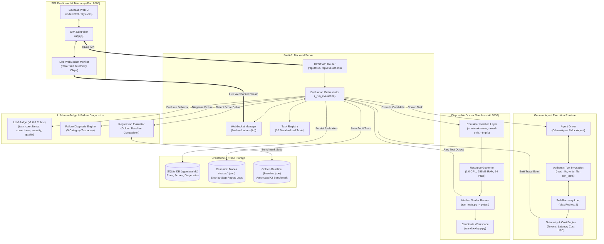
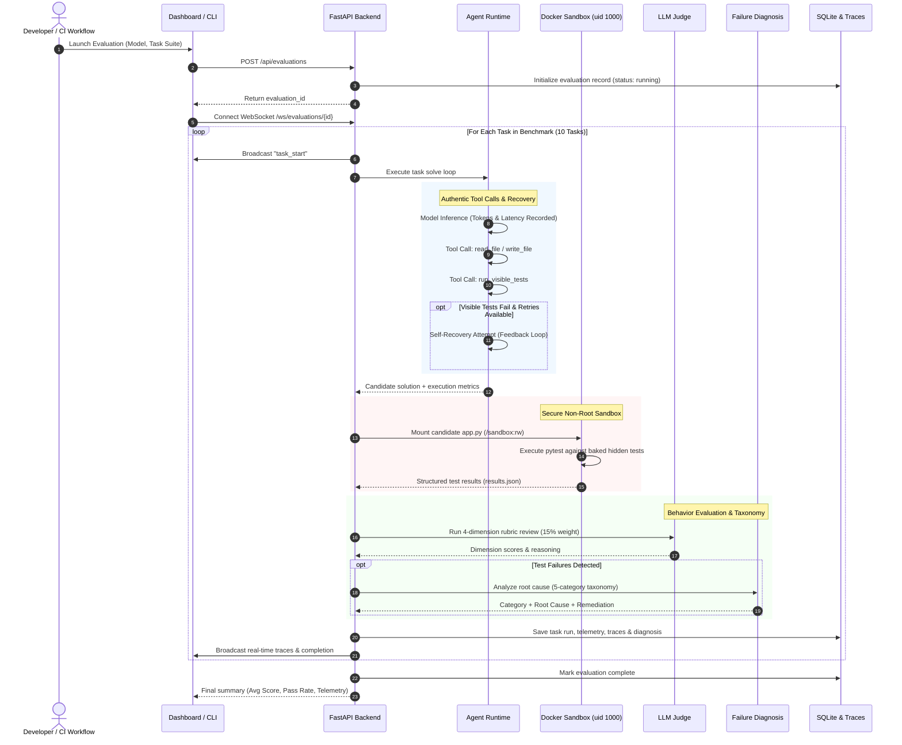
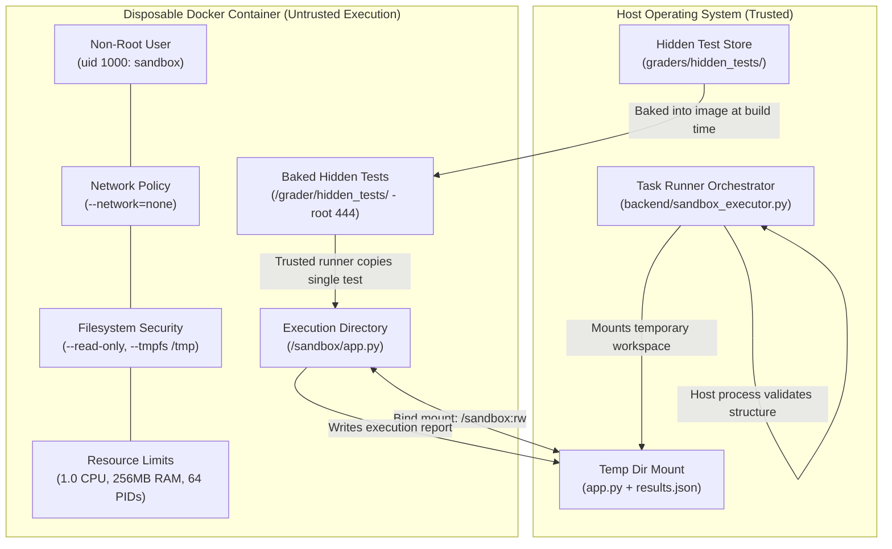
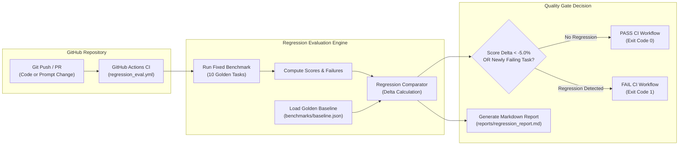

# AgentEval

> **Autonomous AI Agent Evaluation Framework with Docker Sandboxing, LLM-as-a-Judge, and Automated Regression Testing**

AgentEval executes autonomous AI coding agents inside isolated environments and evaluates their final state using **hidden tests**, **behavioral LLM judges**, and **genuine runtime tracing**, rather than relying on self-reported completion or visible test passes.

```
10 Benchmark Tasks   ·   Docker Sandbox (uid 1000)   ·   5-Category Failure Taxonomy   ·   Automated CI Regression
```

---

## Table of Contents

- [The Core Philosophy](#the-core-philosophy)
- [System Architecture](#system-architecture)
- [Evaluation Workflow](#evaluation-workflow)
- [Sandbox Security Boundary](#sandbox-security-boundary)
- [Automated CI Regression Workflow](#automated-ci-regression-workflow)
- [Scoring Formula](#scoring-formula)
- [The 10 Benchmark Tasks](#the-10-benchmark-tasks)
- [Failure Taxonomy](#failure-taxonomy)
- [Quick Start](#quick-start)
- [Verification & Proof of Completion](#verification--proof-of-completion)
- [API Reference](#api-reference)
- [Repository Structure](#repository-structure)

---

## The Core Philosophy

Most AI evaluation benchmarks ask an agent: *"Did you pass the test?"*

AgentEval asks: **"Did you actually solve the problem without introducing security flaws or breaking existing code?"**

The candidate agent sees 1–2 visible tests. The hidden grading engine executes 5–8 unseen tests covering edge cases, input validation, regressions, and security boundaries. The divergence between visible and hidden scores reveals whether an agent produced a brittle patch or a genuine, production-grade solution.

---

## System Architecture



---

## Evaluation Workflow



---

## Sandbox Security Boundary

Untrusted agent code is never executed directly on the host machine. Every evaluation runs inside an ephemeral, locked-down Docker container.



### Security Enforcement Details

- **Non-Root Execution**: Runs strictly as `USER sandbox` (uid 1000). All capability escalation blocked (`--security-opt no-new-privileges`, `--cap-drop ALL`).
- **Complete Network Isolation**: `--network=none` prevents data exfiltration, phone-home beacons, or external downloads.
- **Read-Only Root Filesystem**: `--read-only` root ensures candidate code cannot alter system binaries or python libraries.
- **Strict Resource Caps**: `--cpus 1.0`, `--memory 256m`, and `--pids-limit 64` protect against CPU hogging, memory leaks, and fork bombs.
- **Hidden Test Isolation**: Hidden tests are stored in `/grader/hidden_tests/` (chmod 444/555) outside the candidate workspace. The trusted runner brings in only the test needed for the active task.

---

## Automated CI Regression Workflow

AgentEval continuously enforces code quality and guardrails against performance degradations via automated baseline comparisons in GitHub Actions.



---

## Scoring Formula

Deterministic pytest results remain authoritative (85% aggregate weight), with the LLM judge providing behavioral assessment (15% weight).

### With LLM Judge Enabled

$$\text{Final Score} = (\text{hidden} \times 0.35) + (\text{regression} \times 0.25) + (\text{requirements} \times 0.15) + (\text{quality} \times 0.10) + (\text{judge} \times 0.15)$$

### Without LLM Judge (Fallback / Offline Mode)

$$\text{Final Score} = (\text{hidden} \times 0.40) + (\text{regression} \times 0.30) + (\text{requirements} \times 0.20) + (\text{quality} \times 0.10)$$

> **Passing Threshold**: A task is marked **PASSED** when $\text{Final Score} \ge 70.0\%$.

---

## The 10 Benchmark Tasks

The benchmark suite spans 10 standardized software engineering tasks testing real-world programming competencies:

| # | Task ID | Name | Category | What the Agent Must Address |
|---|---------|------|----------|-----------------------------|
| 1 | `discount` | Discount Calculator | Bug Fix | Correct percentage math and boundary validation (negative/&gt;100% inputs). |
| 2 | `tax` | Tax Calculator | Bug Fix | Correct arithmetic bug while maintaining zero/negative input guards. |
| 3 | `api_endpoint` | GET /users/{id} Endpoint | API | Implement FastAPI endpoint with route parameters, validation, and 404 responses. |
| 4 | `sql_injection` | Fix SQL Injection | Security | Parameterize raw SQL queries and enforce resource authorization checks. |
| 5 | `db_constraint` | Email Uniqueness Constraint | Database | Enforce database-level UNIQUE constraints and handle collision exceptions. |
| 6 | `orders` | Fix Order Total Calculation | Regression | Fix discount calculation without breaking the zero-discount or multiple-item paths. |
| 7 | `rate_limiter` | Token Bucket Rate Limiter | System | Implement thread-safe token bucket rate limiter with burst capacity and replenishment. |
| 8 | `jwt_auth` | JWT Token Authenticator | Security | Validate HMAC SHA-256 signatures, token expiration (`exp`), and claims decoding. |
| 9 | `cache_lru` | LRU Cache Implementation | Algorithm | Implement O(1) eviction cache preserving most-recently-used access ordering. |
| 10 | `data_pipeline` | ETL Stream Pipeline | Data Engineering | Batch, transform, deduplicate, and validate record streams with corrupted entry handling. |

---

## Failure Taxonomy

AgentEval standardizes all evaluation and execution errors into a 5-category taxonomy to enable precise root cause remediation:

| Category | Description | Example Scenario |
|:---|:---|:---|
| `INCORRECT_IMPLEMENTATION` | Algorithm flaws, off-by-one errors, math bugs, or unhandled edge cases. | Discount formula multiplies by 100 instead of dividing by 100. |
| `TOOL_API_ERROR` | Agent invoked tools with invalid arguments, schema errors, or missing parameters. | Tool call supplied malformed file path or invalid JSON payload. |
| `ENVIRONMENT_FAILURE` | Missing dependencies, execution timeouts, or container infrastructure failures. | Container exceeded memory limit or missing runtime package. |
| `SECURITY_VIOLATION` | Insecure coding patterns, string interpolation in SQL, or permission leaks. | Raw string formatting in SQL queries allowing injection bypasses. |
| `REGRESSION` | Solution resolved target problem but broke previously passing regression test cases. | New discount logic broke zero-discount customer orders. |

---

## Quick Start

### 1. Prerequisites

- Python 3.10+
- Docker Desktop (running)
- (Optional) [Ollama](https://ollama.com) for local LLM evaluation

### 2. Install Dependencies

```bash
git clone https://github.com/your-org/ai-eval.git
cd "ai eval"
pip install -r requirements.txt
```

### 3. Build & Verify the Sandbox Container

```bash
# Build sandbox image with all dependencies
python sandbox/build_sandbox.py --force

# Verify containment security proofs (blocked read, host file isolation, network block)
python sandbox/build_sandbox.py --verify
```

### 4. Run the Server & Dashboard

```bash
uvicorn backend.main:app --reload --port 8000
```

Open [http://localhost:8000](http://localhost:8000) in your browser.

- Click **New Eval**
- Select an Agent Model (`Mock Agent` for instant demo or any local `Ollama` model)
- Choose tasks and click **▶ Launch Evaluation**
- Observe live streaming execution telemetry (latency, tokens, cost, exit codes)

---

## Verification & Proof of Completion

Each core capability includes automated test commands verifying correctness:

```bash
# 1. Verify Sandbox Security Isolation (Proof of Completion: Item 1)
python sandbox/build_sandbox.py --verify

# 2. Run Failure Diagnosis & Recovery Unit Tests (Proof of Completion: Item 5)
python -m pytest tests/test_failure_diagnosis_and_recovery.py -v

# 3. Run Automated Regression Evaluation Against Baseline (Proof of Completion: Item 4)
python run_regression_eval.py

# 4. Verify CI Failure on Deliberate Regression (Proof of Completion: Item 4)
python run_regression_eval.py --simulate-regression

# 5. Reproduce Specific Failure via Genuine Trace (Proof of Completion: Item 3)
python reproduce_failure.py <run_id>

# 6. Run Multi-Run Stochastic Benchmark Suite (Proof of Completion: Item 6)
python run_benchmark.py --runs 2 --model mock
```

---

## API Reference

### REST Endpoints

| Method | Endpoint | Description |
|:---|:---|:---|
| `GET` | `/api/tasks` | List all 10 available benchmark tasks and metadata. |
| `GET` | `/api/tasks/{id}` | Retrieve starter code, visible tests, and specification for a task. |
| `GET` | `/api/sandbox/status` | Check Docker daemon availability, image readiness, and judge configuration. |
| `POST` | `/api/evaluations` | Dispatch a new evaluation run across selected tasks. |
| `GET` | `/api/evaluations` | List historical evaluation runs with aggregate metrics. |
| `GET` | `/api/evaluations/{id}` | Detailed results for an evaluation including task runs, scores, and diagnoses. |
| `GET` | `/api/traces/{run_id}` | Retrieve full canonical JSON trace file for a specific task run. |
| `POST` | `/api/traces/{run_id}/reproduce` | Replay candidate code from a trace and reproduce outcome identically. |
| `GET` | `/api/benchmark/summary` | Aggregate benchmark metrics (pass rate, per-category accuracy, latency, recovery rate). |

### WebSocket Endpoint

- `WS /ws/evaluations/{id}`: Streams real-time trace events (`trace_step`, `task_start`, `task_complete`, `evaluation_complete`) with latency, token usage, tool arguments, and exit codes.

---

## Repository Structure

```
AgentEval/
├── .github/
│   └── workflows/
│       └── regression_eval.yml         # GitHub Actions automated regression pipeline
├── backend/
│   ├── main.py                         # FastAPI application & WebSocket connection manager
│   ├── agent.py                        # Model drivers (OllamaAgent, MockAgent)
│   ├── agent_runtime.py                # Genuine tool execution & retry recovery loop
│   ├── grader.py                       # Hidden test orchestrator & weighted scoring engine
│   ├── llm_judge.py                    # LLM-as-a-judge (v1.0.0 rubric & agreement metrics)
│   ├── failure_diagnosis.py            # 5-category failure taxonomy root-cause analyzer
│   ├── regression_evaluator.py         # Automated golden baseline comparison engine
│   ├── benchmark_runner.py             # Multi-run stochastic benchmark runner
│   ├── sandbox_executor.py             # Docker container lifecycle & resource governor
│   ├── database.py                     # SQLite persistence layer & schema migrations
│   ├── tracing.py                      # Canonical event logging & cost/token calculator
│   └── tasks/                          # 10 Standardized Task Modules
│       ├── task_registry.py
│       ├── discount/                   # app.py + visible_test.py + task.json
│       ├── tax/
│       ├── api_endpoint/
│       ├── sql_injection/
│       ├── db_constraint/
│       ├── orders/
│       ├── rate_limiter/
│       ├── jwt_auth/
│       ├── cache_lru/
│       └── data_pipeline/
├── benchmarks/
│   └── baseline.json                   # Versioned golden benchmark baseline
├── frontend/
│   ├── index.html                      # Single-page application UI
│   ├── style.css                       # Bauhaus geometric design system
│   └── app.js                          # SPA client with live WebSocket telemetry
├── graders/
│   ├── judge_ground_truth.json         # Human-labeled ground truth for judge calibration
│   └── hidden_tests/                   # Authoritative hidden tests (never shown to agents)
├── reports/
│   ├── regression_report.md            # Generated before/after regression reports
│   └── benchmark_report.md             # Generated multi-run benchmark comparisons
├── sandbox/
│   ├── Dockerfile.sandbox              # Hardened disposable execution container
│   ├── build_sandbox.py                # Container build & security verification harness
│   └── run_tests.py                    # Non-root in-container test runner
├── tests/
│   └── test_failure_diagnosis_and_recovery.py # Pytest test suite for taxonomy & retries
├── reproduce_failure.py                # CLI failure reproduction tool
├── run_benchmark.py                    # CLI stochastic benchmark launcher
├── run_regression_eval.py              # CLI automated regression evaluation runner
├── requirements.txt                    # Python dependencies
└── README.md                           # Documentation & architecture specifications
```

---

## License

Apache 2.0. Built for evaluating autonomous AI software engineering agents with rigorous empirical standards.
